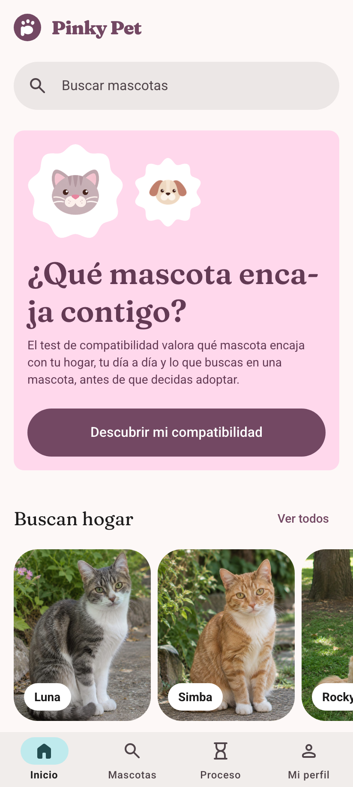
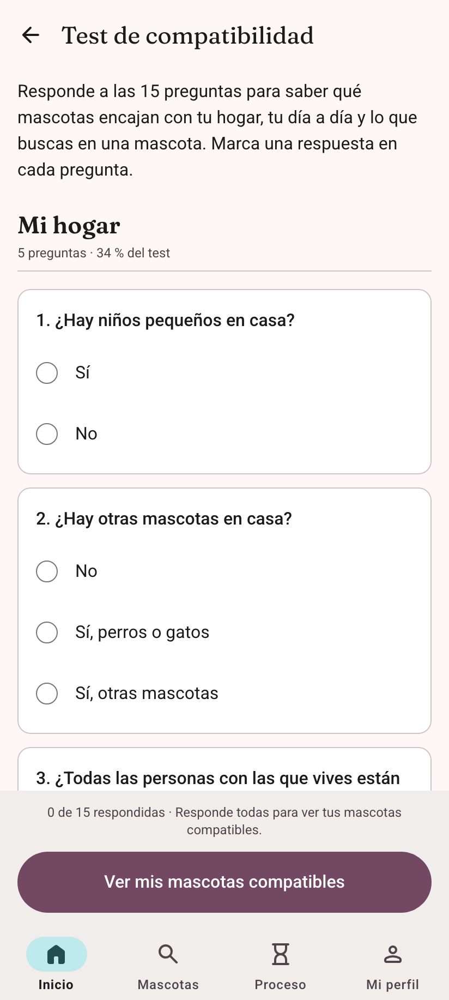
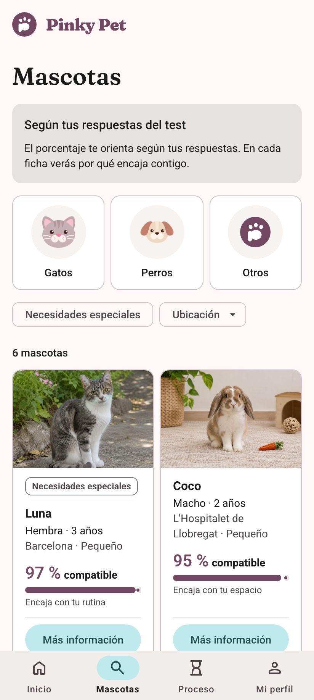
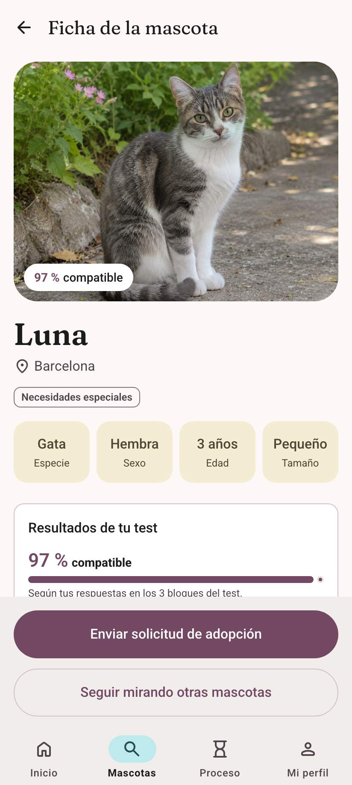
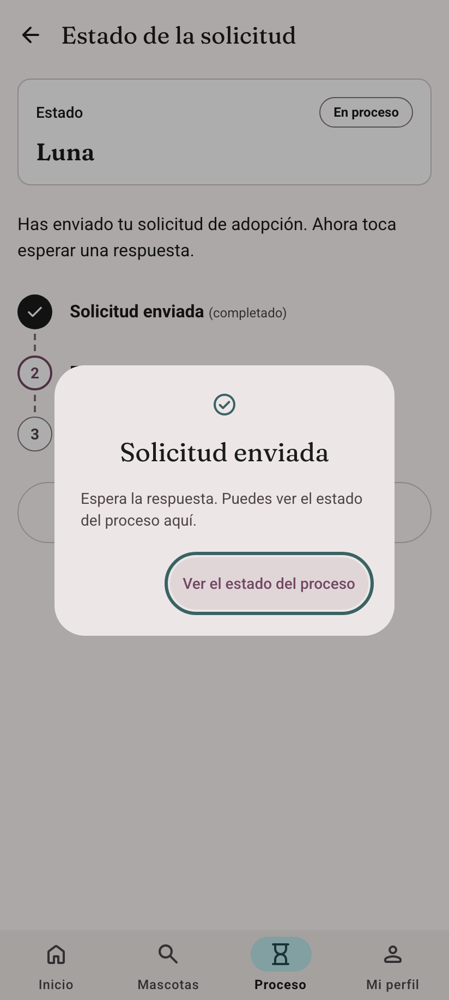

# Pinky Pet · Memoria del proyecto

> App para valorar la compatibilidad entre una persona y una mascota **antes de adoptarla**.
> Proyecto académico de UX/UI · Noviembre de 2026

| | |
|---|---|
| **Web publicada** | <https://pinky-pet-app.onrender.com> |
| **Servidor (API)** | <https://pinky-pet-api.onrender.com> · documentación interactiva en [`/docs`](https://pinky-pet-api.onrender.com/docs) |
| **Código** | <https://github.com/pinkypetsapp1-create/pinkypet> |
| **App Android** | APK de depuración probado en un OPPO Reno 13 |
| **App iOS** | Proyecto listo para el simulador de Xcode (`docs/IOS.md`) |

---

## 1. El problema y la propuesta

Muchas adopciones fracasan porque la mascota no encaja con la vida de la familia: el espacio, el tiempo disponible, la convivencia o el coste. **Pinky Pet** ayuda a decidir con calma **antes** de adoptar:

1. La persona responde un **test de compatibilidad** de 15 preguntas sobre su hogar, su día a día y la mascota que busca.
2. La app calcula un **% de compatibilidad** con cada mascota en adopción y explica por qué encaja.
3. Desde la ficha de la mascota puede **enviar una solicitud de adopción** a la protectora y seguir su estado.

> El algoritmo es una **simulación académica**, no un instrumento validado. El resultado orienta, y la protectora ayuda a confirmarlo.

---

## 2. Cómo hemos trabajado

### 2.1 El diseño manda

Todo el proyecto parte del diseño hecho en **Claude Design**:

| Fuente | Qué contiene |
|---|---|
| **Design System** «Pinky Pet · M3 Expressive» | Tokens (color, tipografía, formas, espacios, movimiento), 41 componentes con su documentación, logotipo, ilustraciones y fotos |
| **Alta fidelidad** | 116 pantallas y estados (claro, oscuro, texto al 200 % y 206 px), con notas de navegación («CONEXIONES») |

El código **no inventa nada visual**: los colores, las letras y las formas salen de los tokens del diseño, y los textos son los literales de las pantallas. Cuando el diseño necesitaba un cambio, se hacía en este orden:

```
Design System  →  Alta fidelidad  →  código
```

Si algo del diseño no se podía implementar bien, se anotaba en `docs/design-feedback.md` y se avisaba al equipo.

### 2.2 Las siete reglas de oro

1. La copia del diseño (`design/`) es de solo lectura.
2. Colores, tipografía, formas, espaciados y movimiento salen solo de los tokens generados.
3. Los textos de la interfaz son los literales del diseño.
4. El código no cambia el diseño.
5. Una sola solicitud de adopción activa por persona, garantizado en el servidor.
6. Ningún secreto en el repositorio.
7. Cada fase termina con evidencia y commit, y espera la aprobación del equipo.

### 2.3 Fases

| Fase | Contenido | Resultado |
|---|---|---|
| **F0** | Conectar con el diseño y montar la sincronización | ✅ Copia versionada del diseño con verificación, mapa diseño → código y especificación |
| **F1** | Servidor: cuentas, mascotas, test, cálculo y solicitudes | ✅ API documentada y probada |
| **F2** | App: componentes del Design System y todas las pantallas | ✅ Comparada con el diseño en claro, oscuro y 206 px |
| **F3** | Publicación en la nube y APK de Android | ✅ Web, servidor y base de datos en línea; APK probado en un móvil real |
| **F4** | Informe Ionic frente a nativo en un Android real | ⏳ Plan propuesto |

El proyecto se desarrolló entre el 23 y el 26 de noviembre de 2026, en **33 commits**.

---

## 3. La app

### 3.1 Estados de la persona usuaria

| Estado | Qué ve |
|---|---|
| **Sin cuenta** | Inicio, catálogo (sin %), cómo adoptar. «Descubrir mi compatibilidad» lleva a Registro |
| **Registrada sin test** | Lo mismo, y los botones llevan al Test |
| **Con test** | El % de cada mascota, sus compatibles ordenadas y sus respuestas en Mi perfil |
| **Con solicitud en proceso** | Además, el estado de su solicitud |

### 3.2 Pantallas

| Sección | Pantallas |
|---|---|
| **Inicio** | Portada según el estado, carrusel de mascotas, «Qué tiene en cuenta el test» (con una ventana para cada bloque) |
| **Cuenta** | Registro (con «Repetir contraseña»), Iniciar sesión, «Continuar con Google», Recuperar contraseña y Nueva contraseña |
| **Test** | 15 preguntas en 3 bloques, con consejos |
| **Mascotas** | Catálogo con filtros (tipo, necesidades especiales y provincia); compatibles ordenadas por % |
| **Ficha** | Foto, datos, resultados del test por bloque, información de la protectora y envío de la solicitud |
| **Proceso** | Cómo adoptar y estado de la solicitud (en proceso, cancelada, finalizada, no disponible) |
| **Mi perfil** | Respuestas del test, modificarlas y cerrar sesión |
| **Errores y vacíos** | Sin conexión, sin compatibles, error al enviar o cancelar, filtros sin resultados |

<table>
<tr>
<td></td>
<td></td>
<td></td>
<td></td>
<td></td>
</tr>
<tr><td>Inicio</td><td>Test</td><td>Compatibles</td><td>Ficha</td><td>Estado de la solicitud</td></tr>
</table>

### 3.3 El test y el cálculo de compatibilidad

**15 preguntas en 3 bloques de 5:**

| Bloque | Peso | Qué pregunta |
|---|---|---|
| 🪑 **Mi hogar** | 34 % | Niños pequeños, otras mascotas, acuerdo de quienes conviven, tipo de vivienda y si permite animales |
| 🕒 **Mi día a día** | 33 % | Horas que estaría sola, tiempo diario, quién la cuidaría si viajas o enfermas, ritmo de vida y experiencia previa |
| 🐾 **La mascota que busco** | 33 % | Tamaño, nivel de actividad, edad, gasto mensual y necesidades especiales |

**Cómo se calcula:**
1. Cada mascota tiene unos **atributos** que salen de su ficha: tamaño, etapa de vida, actividad, vivienda mínima, horas que puede estar sola, tiempo que necesita, convivencia con niños y con otras mascotas, coste mensual, necesidades especiales y experiencia necesaria.
2. Cada respuesta se compara con un atributo y da un nivel: **encaja** (0), **matiz leve** (−5), **encaje parcial** (−15) o **no encaja** (−30).
3. Cada bloque vale 100 menos sus penalizaciones, con un mínimo de 0.
4. **% global = 0,34 · hogar + 0,33 · día a día + 0,33 · mascota**, redondeado.
5. Una mascota es **compatible** si llega al **50 %**.

El % **siempre** sale de las respuestas de cada persona: no hay ningún % fijo por mascota. La fórmula se dedujo del diseño y se comprobó con las seis mascotas originales y la cuenta demo.

### 3.4 Accesibilidad

- **Zonas táctiles de 48 dp** en botones y enlaces.
- **Tema oscuro** completo, con los colores del Design System.
- **Texto al 200 %:** la app aplica el tamaño de letra del sistema Android; los botones crecen en vez de cortar el texto.
- **Reflujo a 206 px** (equivale a ampliar al 200 %): sin desplazamiento horizontal.
- Lectores de pantalla:
  - etiquetas y errores enlazados a sus campos;
  - textos alternativos en todas las fotos;
  - diálogos que devuelven el foco al cerrarse.
- **«Reducir movimiento»:** si está activado, no se muestra la animación del logotipo.

### 3.5 Detalles de experiencia

- **Animación del logotipo** al abrir la app: huellas → sello → el sello vuela al logo de la barra superior (1,55 s, curvas de Material 3).
- **Recuperar contraseña por correo:** enlace de un solo uso que caduca en 1 hora. La respuesta es la misma exista o no la cuenta, para no revelar qué correos están registrados.
- **Móviles estrechos** (menos de 412 px): las tarjetas pasan a una columna para que nada se corte.
- **Barras del sistema** (Android 15 y iPhone): la app deja el hueco de la barra de estado y de los botones del sistema.

---

## 4. Arquitectura

```
┌──────────────────────────┐        ┌────────────────────────────┐       ┌─────────────────┐
│  App                     │  HTTPS │  Servidor (API)            │       │  Base de datos  │
│  Ionic + Angular         │ ─────► │  NestJS · Render           │ ────► │  MongoDB Atlas  │
│  · Web (Render)          │        │  · Cuentas y sesiones      │       └─────────────────┘
│  · Android (APK)         │        │  · Test y compatibilidad   │
│  · iOS (Xcode)           │        │  · Solicitudes             │ ────► Brevo (correo)
│  Capacitor               │        │  · Recuperar contraseña    │ ────► Google (inicio de sesión)
└──────────────────────────┘        └────────────────────────────┘
```

| Parte | Tecnología | Por qué |
|---|---|---|
| **App** | Ionic 9 + Angular 22 + Capacitor 8 | Un solo código para web, Android e iOS, con HTML y CSS fieles al diseño |
| **Servidor** | NestJS 11 (TypeScript) | Estructura clara, validación y documentación automática (Swagger) |
| **Base de datos** | MongoDB (Atlas, gratuito) | Las fichas de mascotas y las respuestas encajan bien como documentos |
| **Alojamiento** | Render (gratuito) | Publica solo con cada cambio en GitHub |
| **Correo** | Brevo (gratuito, 300 al día) | Correos de recuperación de contraseña |
| **Inicio de sesión con Google** | Google Identity (web) y Credential Manager (Android) | Entrar sin crear contraseña |

### 4.1 Servidor: qué ofrece

| Área | Endpoints |
|---|---|
| Cuentas | `POST /auth/register` · `/auth/login` · `/auth/google` · `/auth/refresh` · `/auth/logout` · `GET /auth/me` |
| Recuperar contraseña | `POST /auth/password/forgot` · `GET` y `POST /auth/password/reset` |
| Mascotas | `GET /pets` (con filtros) · `GET /pets/{id}` |
| Test | `GET /test/questions` · `GET` y `PUT /test/answers` |
| Compatibilidad | `GET /compatibility` |
| Solicitudes | `POST /requests` · `GET /requests/current` · `POST /requests/{id}/cancel` |
| Estado | `GET /health` |

**Reglas que garantiza el servidor:**
- **Una sola solicitud activa por persona**, protegida por un índice único en la base de datos: aunque lleguen varias a la vez, solo una entra.
- Enviar una solicitud **exige haber hecho el test**.
- Si la protectora responde, la mascota deja de estar disponible. Si la persona cancela, sigue disponible.

### 4.2 Seguridad

- **Contraseñas** cifradas con argon2id.
- **Sesiones** con token de acceso de 15 minutos y token de renovación que cambia en cada uso. En Android se guardan en el almacén seguro del sistema (Keystore).
- **Límite de intentos** en el inicio de sesión y en la recuperación de contraseña.
- Los **enlaces de recuperación** se guardan cifrados, son de un solo uso, caducan en 1 hora, y al cambiar la contraseña se cierran todas las sesiones.
- **Ningún secreto en el repositorio:** las claves están solo en Render y en un archivo local ignorado por git.
- El **simulador de la protectora** no existe en producción.

---

## 5. Del diseño al código, sin perder fidelidad

| Herramienta | Qué hace |
|---|---|
| `design/` + `design.lock.json` | Copia exacta del diseño, con la huella (sha256) de cada archivo |
| `/sincronizar-diseno` | Trae los cambios de Claude Design, comprueba que todo coincide (0 discrepancias) y los clasifica |
| `npm run tokens` | Genera el CSS de la app a partir de los tokens del Design System |
| Tests de coherencia | Comprueban que la app no tiene colores ni medidas escritos a mano, que las fotos son las del diseño y que los textos de las mascotas y del test son los literales |
| `npm run capturas` y `npm run comparar` | Capturan la app en claro, oscuro y 206 px y la ponen al lado del diseño |
| `/nueva-mascota` | Añade una mascota desde una ficha en castellano: la lleva al diseño, la app, el servidor y las bases de datos |

**177 capturas de evidencia** en `docs/evidencia/`.

---

## 6. Publicación

| Pieza | Dónde | Cómo se actualiza |
|---|---|---|
| Web | Render (sitio estático) | Sola, con cada cambio en GitHub |
| Servidor | Render (servicio web) | Sola, con cada cambio en GitHub |
| Base de datos | MongoDB Atlas (Frankfurt) | `npm run mascotas:subir` para mascotas nuevas |
| Android | APK de depuración (14 MB, Android 7+) | Compilado desde la terminal (Java 25, Gradle 9.1), sin Android Studio |
| iOS | `app/ios/` (Swift Package Manager) | Simulador de Xcode (`docs/IOS.md`) |

**Prueba automática contra la nube** (`npm run smoke`): 9 de 9 pasos. Comprueba salud, registro, test, compatibilidad, solicitud, «una sola activa», estado, cancelación y que el simulador no es accesible.

**Prueba en un móvil real:** el APK se probó en un **OPPO Reno 13**, incluidos «Continuar con Google» y el texto al 200 %.

> El servidor gratuito de Render se duerme tras 15 minutos sin uso y tarda alrededor de un minuto en despertar. Para no dejar la app bloqueada, al abrirse lo despierta, espera hasta 75 s por petición y muestra las pantallas de error del diseño si no responde.

---

## 7. Calidad y pruebas

| Pruebas | Cantidad | Qué cubren |
|---|---|---|
| Servidor, unitarias | 14 | Cálculo de compatibilidad, validación del test y coherencia con el diseño |
| Servidor, de extremo a extremo | 51 | Cuentas, Google, recuperar contraseña, catálogo y filtros, compatibilidad, solicitudes simultáneas y seed |
| Diseño y tokens | 10 | El CSS sale de los tokens, no hay valores a mano y las fotos coinciden con las del diseño |
| Recorridos en el navegador | 3 scripts | Recuperar contraseña (8 comprobaciones), ventanas del test (16) y animación de entrada (6) |
| Contra la nube | 9 pasos | Recorrido completo en producción |

---

## 8. Decisiones destacadas

| Decisión | Por qué |
|---|---|
| Umbral de compatibilidad del **50 %** | Por debajo, la mascota no cuenta como compatible y se muestra el vacío del diseño |
| **Solicitud solo con test** | El diseño lo sugiere y da sentido a la compatibilidad |
| **Simular la protectora** con un endpoint solo de desarrollo | Permite enseñar todos los estados de la solicitud sin una protectora real |
| **«Continuar con Google»** en web y Android | Petición del equipo. En iOS, preparado y pendiente de su cliente |
| **Recuperar contraseña por correo** (Brevo) | Petición del equipo. Se diseñó primero en Claude Design |
| **Una columna en móviles estrechos** | Observación del equipo con el OPPO Reno 13 |
| **Animación en cada apertura** | Petición del equipo. El diseño decía «solo la primera vez» y se cambió antes en el diseño |
| **Ventanas de los bloques del test** | Petición del equipo. Textos escritos a partir de las 15 preguntas reales |

**Aportaciones al diseño** (`docs/design-feedback.md`, 16 entradas). Por ejemplo:
- las fuentes se empaquetan en la app en vez de cargarlas de Google Fonts;
- la etiqueta «Necesidades especiales» parte el texto en vez de salirse;
- los diálogos se desplazan si no caben con la letra grande;
- las barras del sistema de Android 15 tienen su hueco.

---

## 9. Cómo crece el proyecto

- **Añadir mascotas:** rellenar `mascotas/nueva-mascota.md` (cada campo indica sus opciones), dejar la foto en `mascotas/fotos/` y escribir `/nueva-mascota`. La primera mascota añadida así fue **Donatello**, y ahora hay 7.
- **Cambiar el diseño:** se cambia en Claude Design y se trae con `/sincronizar-diseno`.
- **Nueva versión de Android:** tres comandos en la terminal (`docs/DEPLOY.md` §4).

---

## 10. Pendiente

| Qué | Estado |
|---|---|
| **Fase 4: informe Ionic frente a nativo** | Plan propuesto: medir en el OPPO por cable la fidelidad visual, las zonas de 48 dp, el tema oscuro, el texto al 200 %, la animación y la fluidez |
| **iOS en el simulador** | Proyecto listo; falta instalar Xcode (en el MacBook de una compañera) |
| «Continuar con Google» en iOS | Falta crear su cliente en Google Cloud |
| Mantener el servidor despierto (cron-job.org) | Opcional |
| Cambiar la contraseña de Atlas y el token de GitHub | Recomendado al terminar el curso |

---

## 11. Documentación del repositorio

| Documento | Para qué |
|---|---|
| `CLAUDE.md` | Reglas de oro y comandos |
| `docs/SPEC.md` | Especificación completa |
| `docs/design-map.md` | Qué componente y qué ruta corresponde a cada pantalla del diseño |
| `docs/design-feedback.md` | Problemas del diseño y cómo se resolvieron |
| `docs/DEPLOY.md` | Nube, APK e iOS paso a paso |
| `docs/IOS.md` | Abrir la app en el simulador de iPhone en cualquier Mac |
| `docs/CONTINUAR.md` | Cómo retomar el trabajo |
| `design/CHANGELOG.md` | Historial de cambios del diseño |
